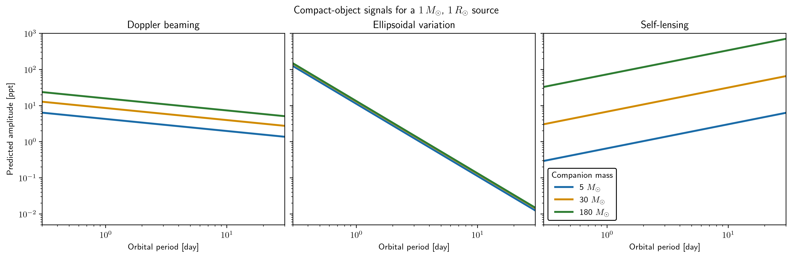

# troia

## Introduction
I use Troia to search time-series data for compact-object signatures in binaries and organize targets for population comparisons. Beaming, ellipsoidal variation, and self-lensing give me different ways to ask what might be orbiting a visible star.

Troia classifies time-series targets and passes the resulting target groups to Pergamon for population comparisons. Given independently determined per-target detection efficiencies, Pergamon can also estimate an occurrence fraction from Troia's detection flags. The current Troia workflow does not measure those efficiencies, so its classification counts alone should not be treated as occurrence rates.

The compact-object photometric amplitudes and derived binary features are calculated by Pergamon. Troia retains its existing imports for workflows that still run target-level time-series searches.

Data products and plots are written under the configured environment-based data tree. Reusable path handling is available in `troia/paths.py`.

## Installation

```bash
python -m pip install -e .
export TROIA_PATH=/path/to/troia
```

`TROIA_PATH` identifies the repository root. Keep runtime inputs in `data/` and generated pipeline outputs in `visuals/`; both directories are ignored by Git. The existing `retr_pathgaia()` helper retains its workflow-specific behavior.

## Example

The example evaluates Troia's photometric-signature calculation over orbital periods from 0.3 to 30 days:

```bash
python examples/compact_object_signatures.py --typefileplot png
python examples/compact_object_signatures.py --typefileplot png --bokeh
```

Install `python -m pip install -e '.[bokeh]'` to also write the interactive period-amplitude comparison as `examples/compact_object_signatures.html`.



The deterministic calculation compares Doppler beaming, ellipsoidal variation, and self-lensing for 5, 30, and 180 solar-mass companions. It assumes a 1-solar-mass, 1-solar-radius source with a mean density of 1.41 grams per cubic centimeter. These are model predictions rather than observed light curves.

